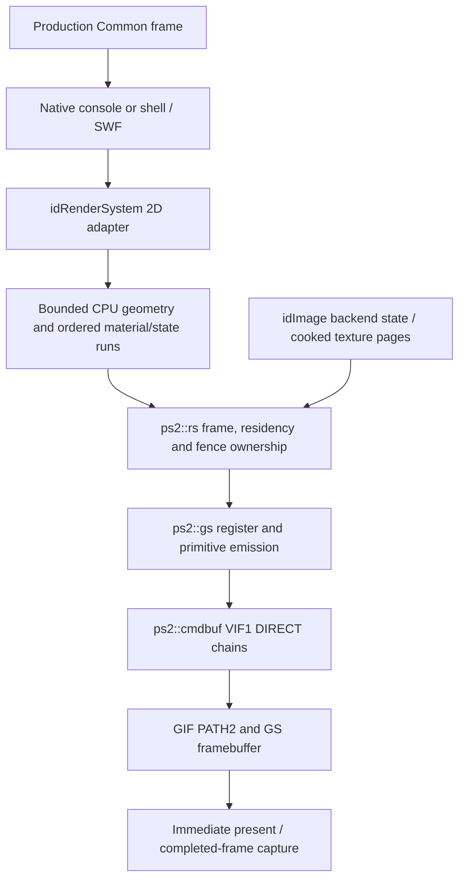

# 2D renderer bring-up and main-menu roadmap

This is the reference inventory and implementation roadmap for the first GS-backed
Doom 2D renderer. Inspection and approval date: **2026-10-14, Australia/Sydney**.
The inventories retain that original source snapshot; implementation progress is recorded
below. Uncompleted gates, budgets and destinations remain proposed.
It expands the 2D portion of M4 in [IMPLEMENTATION_PLAN.md](IMPLEMENTATION_PLAN.md).

## Implementation progress

**2D-1 and 2D-2 are accepted in PCSX2 in debug and release.** The backend owns aligned command
halves, resets/claims VIF/GIF/GS state, draws clipped solid sprites with alpha, alternates
contexts and immediately presents completed frames. One integrated native test covers
120 frames, reloads, buffer pressure and exact cleanup in NTSC/PAL; three failure probes
verify release-safe bounds and wait deadlines. Direct RGBA textures now support nearest/linear
filtering, logical edge clamp and POT repeat, with bounded owned pixels and page-aligned
LRU residency. Dirty uploads, evictions and destruction fence queued references. Native
strip readback streams checked TGAs and restores the pipeline after injected timeout.
The production executable remains headless and links no fixtures. Native image providers
and UI drawing remain pending.

See [PORT_STATUS.md](PORT_STATUS.md#cpu-only-gs-bring-up-2d-1) for measurements and run
identities. The [2D-2 NTSC](images/renderer-2d-2-ntsc.png) and
[PAL](images/renderer-2d-2-pal.png) images are native unscaled readback, with 24 scene
pixel checks plus upload/pressure checks. See the [2D-2 acceptance record](PORT_STATUS.md#rgba-textures-and-native-capture-2d-2).
**2D-3 is in progress:** intrinsic white/ASCII images and native display/color/state/
axis-quad/text adapters are now verified through the existing scene. Native adapter
captures cover 26 additional pixels, 120 frames and reload; the real native console
and Common presentation lifecycle remain next. See the
[adapter acceptance record](PORT_STATUS.md#native-console-drawing-adapters-2d-3-first-slice).
Physical PS2 acceptance remains 2D-8.

## Scope and completion criteria

Bring the production `d3bfg.elf` from its current native headless console to a visible
console, then a rendered and navigable Doom 3 main menu. Reuse the Quake II PS2 hardware
layer, retain Doom's useful GUI/SWF contracts, and introduce a bounded CPU 2D submission
path. A functioning GS sprite demo is the first hardware gate, not main-menu acceptance.

The main-menu gate requires native menu/SWF state, readable localized text, correct
layering/transparency/clipping, focus and selection, console toggling, continued frames
and orderly quit. A production screenshot and a confirmed menu state must agree.
An authored menu-shaped drawing does not establish native BFG shell acceptance.

Keep the existing headless path and test executables working. Sound output, world
rendering, lighting, shadows, VU1 programs, campaign map/player startup, online services,
saves and cinematic playback are outside this first 2D effort. Menu entries for unavailable
operations must be hidden or disabled explicitly. First menu input can be injected engine
key events; usable pad or keyboard navigation is a separate final integration gate.

## Inspection baseline

| Checkout / evidence | Inspected state |
| --- | --- |
| Doom | `/Users/guilherme/Repos/GitHub/doom3-bfg-ps2`, commit `908c116bc17d086f122933c5295ed985d99d96b6`; clean before this document |
| Quake II reference | `/Users/guilherme/Repos/GitHub/quake2-ps2`, commit `e64493c1bbadd84b2ab5d52a128ef25905236510`; clean at inspection |
| Doom renderer backend | Six files under `src/ps2/renderer/`; no GS setup, texture payloads or draw submission |
| Quake renderer backend | 22 `.cpp`, 22 `.h`, two `.vcl` and two `.i` files under `src/ps2/renderer/` |
| Doom resident source groups | 281 retained campaign units; 343 production direct link inputs, 345 campaign-test inputs at the recorded baseline |
| Renderer/UI source dispositions | 38 renderer, 21 SWF and 29 menu/widget units in `campaign_runtime`; 20 renderer units in `ps2_replacement`; 29 menu/scoreboard units in `deferred_runtime` |
| Toolchain / SDK | Existing GCC 15.2 EE build; ps2sdk `graph`, `draw`, `packet2`, `dma` are the Quake renderer's low-level dependencies |
| Retail data | `gamedata/d3_bfg/` contains 64 `.resources` files; root `base/` has no loose SWF/font/bimage resources |
| Current runtime evidence | Prior debug/release headless boot, 120-frame/live-quit checks and authored map/player regressions are recorded in [PORT_STATUS.md](PORT_STATUS.md); no build, emulator or hardware checks were rerun for this documentation pass |

Paths prefixed **D:** refer to the Doom checkout; **Q:** refer to the Quake checkout at
the commits above. These are source-inspection facts, not a claim that Quake's behavior,
capacities or performance measurements have been reproduced by Doom. Existing reused
files retain their earlier provenance in [REUSE.md](REUSE.md); this newer reference
snapshot does not change that history.

## Doom renderer and UI inventory

| Area | Files / entry points | Present implementation and 2D consequence |
| --- | --- | --- |
| Production ownership | D: `src/ps2/system/headless.cpp`, `main.cpp`; `Common.cpp::Init/Shutdown`, `common_frame.cpp::Frame` | Native game and console initialize, but frames never call console/menu drawing. `NOMAP` native `RunFrame` returns without map simulation. Add optional presentation to this production lifecycle; do not switch on the desktop frame loop wholesale. |
| Logical renderer | D: `src/ps2/renderer/null_render.{h,cpp}` | Binds native `tr` / `renderSystem`; owns CPU models/worlds and a positive logical frame stamp. Default material must be stage-free. Physical initialization, display queries, color/state setters, all draw calls and swap/submit methods fail explicitly. Keep CPU ownership while replacing the required 2D method providers. |
| Controls / source import | D: `src/ps2/renderer/render_cvars.cpp`, `model_import.cpp` | Referenced native renderer cvars retain defaults/flags, but do not imply a device. ASE/LWO/MA source-model import fails explicitly. Add backend controls only as implemented and document them in `CVARS.md`; retain host conversion for source models. |
| Images and programs | D: `src/ps2/renderer/image_stubs.cpp`; `src/neo/renderer/Image.h`, `ImageOpts.h` | Native `idImage::backendState` is the existing extension point. Image-manager lookup/generation/loading and all active image methods are unavailable. OpenGL image names and shaders are not a GS abstraction; implement typed PS2 image state and intrinsic images, leaving GPU programs unavailable. |
| Geometry storage | D: `src/ps2/renderer/vertex_stubs.cpp`; `VertexCache.h`, `GuiModel.{h,cpp}` | Only empty buffer metadata and cleanup exist. Native GUI collection relies on mapped vertex/index storage, material/state runs and frame handles. Allocate bounded CPU storage; no GL/VBO/joint pools are required for screen-space UI. |
| Public drawing contract | D: `src/neo/renderer/RenderSystem.{h,cpp}`, `tr_local.h` | `SetColor`, `SetGLState`, both `DrawStretchPic` forms, `DrawStretchTri`, `AllocTris`, small/big text and display metrics are the useful seams. `RenderSystem.cpp` is a replacement source, so its algorithms must be adapted or selected method by method, avoiding duplicate stub definitions. |
| Native console | D: `src/neo/framework/Console.cpp`, `EditField.cpp`, `KeyInput.cpp` | Already initialized, active and receiving prints. `console->Draw` needs fills, charset quads and optional graph/text overlays. A visible native console is attainable before SWF/font/menu integration. Production `UpdateScreen` currently returns without drawing. |
| Materials | D: `src/neo/renderer/Material.cpp`, `Material.h`, `Image_program.cpp` | Parsing and register evaluation are retained, but real stages trigger currently unavailable image services. Start with explicit UI material profiles and evaluate time/color/alpha registers; validate every material stage before emission. |
| SWF runtime | D: `src/neo/swf/` (21 compiled units) | Runtime, scripts, timeline, shapes, JPEG/zlib and binary/text loading compile. Active SWF execution is not yet accepted. `SWF_Render.cpp` writes indexed `idDrawVert` geometry, affine coordinates, `color` and `color2`, material and GLS state. Sprites alone cannot implement this interface. |
| Fonts and localization | D: `src/neo/renderer/Font.{h,cpp}`, `SWF_Text*.cpp`, `framework/Common_localize.cpp`, `idlib/LangDict.cpp` | Font code is retained; `RegisterFont` remains unavailable. Font metadata uses `newfonts/<name>/48.dat` and optional `old_{12,24,48}.dat`, with a material for the atlas. Locale/font aliases and `#str_*` labels need an explicit menu package. Audit glyph/index ownership: the current font destructor deletes `fontInfo` but not its raw `glyphData` / `charIndex` allocations. |
| Shell provider | D: `src/ps2/ui/shell_stub.cpp`; `src/neo/d3xp/menus/MenuHandler_Shell.cpp`, `MenuScreen_Shell_*.cpp` | Shell initialization, activation, updates and events fail by method name; only empty cleanup is accepted. Original shell/root/press-start units are deferred, contain unported RTTI and instantiate many more screens than the first root needs. Enable a reviewed subset, not all deferred menus. |
| Common menu / dialog | D: `src/ps2/system/common_campaign.cpp`; `Common.cpp::CreateMainMenu`, `Common_menu.cpp`; `Common_local.h::Dialog` | `StartMenu`, `ExitMenu`, `MenuEvent` are unavailable. `CreateMainMenu` invokes declaration/render/sound/legacy-UI level-load hooks and native shell creation. `Dialog()` currently terminates on PS2. A rendered root cannot run unchanged until these contracts are bounded and meaningful. |
| Session / input / sound | D: `src/ps2/system/offline_session.cpp`, `input/usercmd_stub.cpp`, `audio/sound_backend.cpp`, `system/sys_services.cpp` | Offline sign-in/session states exist, but save manager and device services remain unavailable. User-command sampling, mouse capture and rumble fail. Rendering/menu events need their own input routing; do not enable player command generation or audio devices to navigate a menu. |
| Existing verification | D: `src/tests/smoketests/renderer_tests.cpp`, `src/tools/scripts/run_headless.py`, `run_pcsx2_test.py`, `link_resident.py` | Existing renderer tests accept inactive binding/metadata behavior, not pixels. Add one integrated 2D acceptance scenario under tests; production must retain zero test inputs and fixture symbols. |

The most important distinction is **compiled interfaces versus usable UI**. The native
SWF/widget sources and JPEG tests already provide useful code, but none establish a
loaded shell, a font, a GUI vertex pool or a drawn pixel.

## Quake II PS2 renderer inventory

| Component | Reference files | Reuse value and dependencies |
| --- | --- | --- |
| GS setup / emission | Q: `src/ps2/renderer/gs.{h,cpp}` | Two GS drawing contexts, framebuffers/Z buffer, register builders, uploads, rectangles, presentation and row readback. Present code also assumes Quake global/lit palettes, alpha CLUT, texture records and splash state; initialization has no corresponding general shutdown API. Split and adapt those assumptions. |
| Packet cursor | Q: `src/ps2/renderer/gif_writer.h` | Non-owning libdraw cursor, register writes and upload/rect helpers. **Capacity checks are debug-only**, and helper post-checks occur after writing. Doom must reserve worst-case output and check capacity in release before writes. |
| Command chain | Q: `src/ps2/renderer/cmd_buffer.{h,cpp}` | Double-buffered packet2 VIF1 source chains, DIRECT blocks, reservations, inline payloads, emergency drains, cache writeback and GS FINISH fences. Current halves are **768 KiB each**, borrowed from BSP scratch. Keep the contracts; replace scratch borrowing and fixed capacities with owned renderer buffers. Debug-only hang polling becomes bounded release polling too. |
| Frame / 2D scheduler | Q: `src/ps2/renderer/render_system.{h,cpp}` | `BeginFrame`, pending 2D blocks, `FillRect`, `DrawTexturedRect`, texture residency and `EndFrame(deferPresent)`. Currently imports clip/math/VU interfaces and unconditionally calls `vu1::Init`. Extract the CPU/GIF 2D path; VIF1 DIRECT does not require a VU1 microprogram. |
| VRAM allocator | Q: `src/ps2/renderer/vram.{h,cpp}` | Block footprint accounting, first-fit/coalescing, LRU, frame pins, dirty/reuse hazards, recoverable allocation failure and defragmentation. Metadata is tied to `tex::Texture`, with 512 block descriptors. Preserve fencing guarantees and use a Doom texture/page record. Footprints must be validated for each enabled format. |
| Texture record / cache | Q: `src/ps2/renderer/texture.{h,cpp}`, `image_load.{h,cpp}` | Formats, sampler/stride/POT helpers, dirty pixels and registry lifecycle are useful. The 640-slot cache, Quake image classes, model surface chains, global palette, intensity, PCX/WAL/TGA loading, WAL mips and registration policy are unsuitable as Doom policy. Reuse mechanisms, replace identity/ownership/load policy. |
| CLUT / atlases | Q: `src/ps2/renderer/clut.h`, `scrap_atlas.{h,cpp}` | CSM1 entry reordering and skyline packing are candidates. A shared alpha-ramp CLUT suits coverage fonts. Quake's immortal global color palette and monotonic Pic atlas lifetime do not describe reloadable Doom UI atlases. |
| Qword operations | Q: `src/ps2/qwords.h` | Integer EE `lq/sq` copy/store helpers for aligned GIF data. Optional after correctness; adapt inline macros and validate alignment at ownership boundaries. These are EE instructions, not a reason to import VU tool dependencies. |
| Video selection | Q: `src/ps2/system/video_mode.{h,cpp}` | ROM-based NTSC/PAL, visible-line limits and timing/display constants. Replace `Q_stricmp` and Quake cvars with Doom/backend policy. Quake currently defaults to width 640, automatic height/standard and 16-bit color; the Doom proposal remains width 512 initially. |
| Capture / diagnostics | Q: `src/ps2/renderer/screenshot.{h,cpp}`, GS row download; `debug/pipeline_dump.*`, `renderer/profile.*` | Strip-based readback/TGA conversion and pipeline registers are valuable. Adapt filesystem/logging/profiling. GS download contains unbounded FINISH/FIFO/DMA waits and must restore BUSDIR/FDR/IMR/PATH3 state on failures. Do not import the whole Quake debug framework. |
| Engine adapter / display / loading | Q: `src/ps2/renderer/ref.cpp`, `vid.cpp`, `loading_screen.*`, `splash_screen.*` | Reference frame flow, glyph drawing, standalone immediate present and capture call sites. Quake `refexport_t`, `viddef`, overlays and BSP registration stay behind. Doom uses `idRenderSystem` and Common ownership. |
| Deferred renderer groups | Q: `view.*`, `model*`, `lightmap.*`, `md2.*`, `sky.*`, `cinematic.*`, `vu1.*`, `vu1progs/`, `clip.*` | Not needed for first 2D pixels. The current clipper is a 3D/VU-layout clipper, not a drop-in nested SWF mask implementation. Refer to it for bounded interpolation, then implement 2D clipping explicitly. |

Quake links `draw`, `graph`, `packet2` and `dma` directly; gsKit is installed locally
but is not the selected rendering API in this reference. Do not introduce a second
GS resource owner during reuse. Its VU tools live at `src/tools/{vclpp,vu-checker}`;
if needed later, Doom imports belong under `src/external/` and use pinned builds.
No VU tool/submodule import is required for this CPU 2D roadmap.

## Reuse and adaptation map

Original proposed destinations are relative to D:. Device, direct RGBA texture and
capture subsets now exist; native UI/image/font providers and coverage/CLUT work remain
subsequent gates.

| First-pass destination | Start from | Required adaptation |
| --- | --- | --- |
| `src/ps2/renderer/gs.{h,cpp}` | Q: GS | Keep device/context setup and primitive/register helpers; detach palette/intensity/splash/VU includes; add explicit drain/shutdown and format/config validation. |
| `src/ps2/renderer/gif_writer.h` | Q: GIF writer | Preserve non-owning cursor; release-safe preflight bounds and audited libdraw emission sizes, including terminators. |
| `src/ps2/renderer/cmd_buffer.{h,cpp}` | Q: command chain | Renderer-owned aligned halves, runtime capacities, DIRECT-only emission, completion/error policy and statistics; no world loader borrowing. |
| `src/ps2/renderer/render_system.{h,cpp}` | Q: `ps2::rs` frame/residency/2D portions | CPU 2D frame owner, ordered commands, immediate presentation first, replay state after drains; omit VU batches. |
| `src/ps2/renderer/vram.{h,cpp}`, `texture.{h,cpp}`, `clut.h` | Q: allocation, format and CLUT mechanisms | Typed Doom texture/page storage, tagged allocator hooks, lifecycle and release-safe validation; direct RGBA and coverage formats first. |
| `src/ps2/system/video_mode.{h,cpp}` | Q: video selection | Existing Common cvars/logging/types and explicit supported dimensions/standard; preserve headless startup. |
| `src/ps2/renderer/capture.{h,cpp}` | Q: screenshot / GS download | Matched completed-frame selection, aligned strips, checked writes and bounded state-restoring readback. |
| `src/ps2/renderer/ui_draw.{h,cpp}` | New Doom adapter using retained algorithms | Supply native 2D methods, bounded GUI allocations, material/state interpretation and CPU triangles. Separate hardware-facing `ps2::rs` from the native `idRenderSystem` provider. |
| `src/ps2/renderer/image_backend.*`, `font_backend.*` (if separate providers help) | D: image/font interfaces plus Q: texture helpers | Replace only enabled stub methods, registry/intrinsic/font ownership and converted page loading; do not enable GL implementations. |
| `src/ps2/ui/shell_stub.cpp` / a later bounded shell provider | D: shell/widgets/root/press-start algorithms | Native shell state with reviewed root screens; retire duplicate stubs, convert casts through existing checked queries, remove Classic/online/save/video startup dependencies. |

Reuse the user's own Quake code under the already-authorized GPL v3-or-later terms;
new banners and diagnostics follow AGENTS.md. Record imported paths/commit/adaptations
in README's attribution section and [REUSE.md](REUSE.md). Preserve third-party notices
where present. Quake embedded `builtin/` artwork/palettes are game data generated by
`imgdump`, not automatically reusable engine code; use authored or separately licensed
bootstrap graphics. Proprietary Doom input and converted output remain local/ignored.

Build integration must cover both **Make and `src/tools/scripts/link_resident.py`**.
At the inspection baseline the resident linker hardcoded `-lkernel -lm -lpatches`;
modifying `EE_LIBS` alone could not link GS into production. 2D-1 now passes an audited
library list from Make and records it in link reports/stamps. Register sources in the relevant strict groups,
put cold initialization/capture code in `SIZE_OPT_CXX_SRC`, run the source audit and
regenerate the compile database. Keep one provider per native method/global and retain
the production test-input/symbol rejection gate.

## Proposed 2D rendering architecture

### Device, frame and headless contracts

- Keep native `tr` / `renderSystem` identity and CPU world/model queries. Add an explicit
  2D/device capability; never return `IsOpenGLRunning=true` to satisfy a caller. Audit
  `R_IsInitialized` callers when reporting GS readiness, since it currently returns false.
- Select headless versus display mode before allocating device resources. Current
  `d3bfg.cfg` executes after `InitHeadless`, so an init-time display cvar in that file
  cannot work without a reviewed earlier configuration phase. Prefer one production
  binary with an explicit boot policy/package; keep numeric test defines unchanged.
- Foundation, declarations, native game, logical CPU renderer and optional 2D resources
  remain individually owned startup stages. Preserve stage-free model materials for
  headless map tests; visible intrinsic/UI materials are a separate supported profile.
- One Common frame owns one GUI frame: process events/commands, advance UI clock and
  logical frame stamp once, collect 2D output, submit and present. No nested frames.
  Headless pacing stays unchanged; displayed frames use the chosen present clock,
  avoiding an extra 60 Hz sleep after a vsync wait. PAL/NTSC UI animation uses elapsed
  time rather than assuming every presented field is a 60 Hz game tick.
- Start with `EndFrame(deferPresent=false)`. Drain and display the final frame before
  capture, teardown or a loading pause. Enable deferred presentation only after a
  captured baseline and explicit first/last-frame checks.
- `UpdateScreen` from console submission becomes a safe redraw request or a separate
  completed 2D frame when no frame is open. It must not enter desktop Draw/swap/thread
  code. Quit drains all references before freeing buffers, images, palettes or fonts.

### Geometry and coordinates

Start with opaque/translucent fills and axis-aligned textured sprites. Then add
screen-space indexed triangles for transformed quads, SWF shape fills, morphs and
strokes. Axis-aligned fast paths must preserve the same order and state as triangles.
Allocate first, let the native caller fill returned `idDrawVert` memory, and consume
it only after it is complete; `AllocTris` cannot emit immediately on entry.

Reuse native GUI collection algorithms and material/state runs, but replace the
desktop `EmitFullScreen` route through `R_FrameAlloc`, view definitions and 3D backend
commands with a 2D consumer. Preserve compatible CPU frame handles where retained code
needs them; no static/world/joint vertex storage is promised by this phase. Overflow
flushes only completed runs or rejects an oversized single request before mutation.
State is restored after every chain drain; no silently dropped widgets or stale handles.

Doom's ordinary GUI/console uses a 640×480 virtual canvas. SWF also computes its own
frame scaling through `GetWidth`, `GetHeight` and `GetPixelAspect`, then produces virtual
coordinates. Define that contract once to avoid scaling twice. Keep fractional/subpixel
coordinates through the adapter, map to GS fixed point only at emission, and clip before
coordinates can wrap. Mirror the same viewport/letterbox transform for hit testing.
Scissor clips rectangles; arbitrary SWF masks require a separate solution below.

### Materials, color and blending

Implement a declared first UI profile: unlit single texture or solid color, sampler
clamp/repeat/filter, evaluated color/alpha, opaque overwrite, straight-alpha and selected
additive blends. Native GLS bits are input descriptions to translate, not OpenGL calls.
Validate complete state/material requests before writing packets; unsupported state
produces a feature-specific diagnostic. A fallback must be explicitly selected and tested.

Three reference gaps are mandatory gates:

1. Q: `EmitTexturedRect` disables blending and fixes vertex alpha at `0x80`; it performs
   alpha-test cutout, not smooth UI transparency. Add per-draw/per-vertex color and true
   textured alpha blending. GS alpha unity is `0x80`; textured MODULATE RGB unity is also
   `0x80`, while an untextured full-white fill uses full-range RGB. Keep these conversions
   distinct from Doom's byte colors and texture RGBA representation.
2. D: SWF's normal GLS state is `ONE, ONE_MINUS_SRC_ALPHA`. The supplied `gui.pixel`
   computes texture × multiplier + additive color, then premultiplies RGB by output alpha;
   `gui.vertex` decodes `color2` from packed biased values. Straight-alpha GS blending can
   match the zero-additive profile using straight texture/color data, but simply copying
   packed `color2` or the Quake blend equation does not implement full SWF color transforms.
   Nonzero additive transforms and alpha-affecting transforms need host-baked/static
   variants or a bounded, measured composition path. Do not discard `color2` silently.
3. GS cannot express every GLS multiply/min/max/subtract combination in one ordinary
   texture blend pass. Inventory actual shell use, classify exact supported equations,
   and gate each other mode behind conversion, explicit UI adaptation or bounded software
   composition. A guessed generic `SetGLState` success would hide missing visuals.

The shader reference here is the locally supplied `base/renderprogs/gui.{vertex,pixel}`;
it defines Doom's GUI output semantics, not a shader to run on the GS.

### SWF masks

`SWF_Render.cpp` emits mask geometry using stencil increment/decrement and an equality
test at `128 + activeMasks`. The GS destination-alpha test is not an 8-bit stencil
counter, and a 16-bit framebuffer provides only one destination-alpha bit. Ignoring
those GLS bits or replacing every mask with a bounding rectangle is incorrect.

First accept a deliberately mask-free authored SWF. Then profile masks in the real
shell. Handle rectangular clips with scissor, convex masks with bounded CPU polygon
clipping and interpolated UV/color, and classify concave/nested masks explicitly.
Evaluate a triangulated clip representation or bounded software coverage/composition
for the required remainder; either needs captured equivalence tests and a RAM/fill-cost
budget. A one-bit GS mask is an optional separately validated special case, not general
SWF support. Retail shell acceptance waits for its actual required masks.

## UI assets and menu dependencies

### Read-only retail inventory

The two startup containers were indexed directly using the source format in
`File_Resource.{h,cpp}` / `File.cpp`: big-endian header/table counts and offsets, with
little-endian string lengths. Bounds and exact table consumption were checked; no
resource payload was extracted or copied into the repository. Image header inspection
used `BinaryImageData.h` and `ImageOpts.h`. Stored bytes are not runtime residency.

| Resource observation | Result |
| --- | --- |
| `_common.resources` | 80,383,351 bytes; 2,262 entries, ten compiled SWF entries and 42 `newfonts/` metadata entries |
| `_ordered.resources` | 11,311,441 bytes; 1,336 entries, one compiled SWF entry and 21 `newfonts/` metadata entries |
| Main shell | `generated/swf/shell.bswf`, 655,243 bytes; present in both containers |
| Dialog | `generated/swf/dialog.bswf`, 87,751 bytes in `_common` |
| Other compiled UIs in `_common` | HUD, PDA, pause, loading/default, doomintro, roeintro, leintro and save_indicator |
| Shell atlas | `generated/images/generated/swf/shell#__0200.bimage`, 4,287,456 stored bytes; header: 1408×2320, DXT5, default color, three levels |
| Shell decoded base estimate | 13,066,240 RGBA bytes (~12.46 MiB), before mips/POT padding; cannot fit as a single GS allocation |
| Common Latin font atlases | `arial_narrow`, `bankgothic_md_bt`, `chainlink_semi_bold`: 512×640; `microgrammadbolext`: 640×768; DXT1 with `CFM_GREEN_ALPHA`, six levels |
| Larger font candidate | `dfpheiseigothicw7`: 1920×1920, DXT1/green-alpha; localized glyph selection/paging is required rather than eager whole-font RGBA loading |

These are **candidate dependencies**, not a full shell feature/dependency inventory.
The latter must resolve dictionary image/material references, font usage, language
strings, sprite paths, action scripts, gradients/morphs/strokes, masks/blend/color
transforms, optional sounds and intro/video materials. Duplicate entries in startup
containers require a documented priority/content-hash policy, not two allocations.

### Asset path to the target

- Use authored intrinsic white/charset/textured diagnostic assets first; do not wait
  for a retail converter to bring up fills and a visible console.
- Build a bounded host container/dependency inventory and UI conversion tool before
  enabling the retail shell. Preserve normalized logical names, versions, hashes,
  dimensions, color/alpha semantics, atlas remaps and feature classifications in the
  output manifest. Conversion output goes to an ignored local/package path.
- Prefer cooked binary UI and atlas pages. The retained SWF constructor looks for
  `generated/swf/<name>.bswf` and a generated atlas material; fallback `LoadSWF` expands
  a whole compressed stream and writes an atlas/binary cache on the target. That path
  is unsuitable as the default first retail load. Validate binary/shape/script/count
  input too; compiled source is not a trusted-input proof.
- Decode DXT on the host and restore font alpha from the green channel where
  `CFM_GREEN_ALPHA` specifies it. Keep font metrics and glyph indices consistent with
  any atlas resampling/repacking. English is the first locale gate, not permission to
  break non-Latin glyph mapping later.
- Split/repack the shell atlas into bounded pages and a UI working set. Preserve logical
  image size and native atlas UV semantics, with either dictionary remapping or backend
  page-boundary triangle splitting. Merely dividing the image bytes while keeping old
  UVs is wrong. Atlas gutters/filter edges, alpha coverage and font readability are
  conversion acceptance checks; any downscale policy is explicit and reversible.
- Native `_white`, charset material, `guiSolid`, cursor materials, shell/dialog materials,
  font materials and localized strings are the minimum families to inventory. Disable
  intros/videos explicitly for initial menu startup rather than calling cinematic stubs.

### Native menu closure

The intended integration route is Common menu startup → `game->Shell_CreateMenu(false)`
→ native `idMenuHandler_Shell` / selected screens → SWF scripts/widgets → 2D adapter.
Keep the shell/root behavior where practical, while using the existing one-user offline
session. `Shell_SyncWithSession` already maps offline `PRESS_START` / `IDLE` to shell
state; input-driven transitions still need acceptance.

The original shell initializer instantiates online, load/save, resolution, controls,
credits and other screens, plus intro/video/music materials. A first root needs a
scoped initializer/provider and reviewed root/press-start/widget contracts, with
required named sprite paths such as `menuMain/info/options`. Do not enable all 29
deferred menu/scoreboard sources to satisfy one initializer. Reclassify each newly
enabled unit in the inventory and tag its portability/capability edits. Avoid duplicate
definitions with `shell_stub.cpp` and `common_campaign.cpp`.

Implement meaningful bounded dialog/query state before any shell code calls `Dialog()`;
stock root Quit may require a confirmation dialog. Scope level-load hooks to owned
2D assets instead of initializing the desktop renderer or every legacy GUI. Load
localization explicitly, gate optional music/sample lookups while playback stays off,
and keep save enumeration, leaderboards, online lobbies and Classic switching unavailable.

Route focus/select/back/console events through native menu/console handling before
considering pad/keyboard polling. Production `ProcessEvent` currently routes only to
the console, and console close currently reaches unavailable mouse capture. Supply
headless/display-aware cursor behavior; no fake desktop window, rumble or player
user-command sampling is needed. Reuse Q: `input/pad.*` / `keyboard.*` only when the
visual/input contracts are stable, adapting their events and IOP/module dependencies.

## Memory and frame ownership

### Recorded baseline and proposed starting envelopes

Prior production measurements are fixed `PT_LOAD` 10,863,078 debug / 11,282,726 release
bytes, tagged ready backing 1,942,752 bytes and arena peaks 1,957,402 / 1,959,642 bytes.
These are the headless baseline in [PORT_STATUS.md](PORT_STATUS.md), not new measurements.
Do not add tagged backing to arena commitment again; kernel, stacks and later UI assets
need separate accounting.

| Allocation / format | Initial proposal, to verify on the EE |
| --- | --- |
| Video | 512×448 NTSC first; 512×512 PAL acceptance next, 16-bit color, mono, no multisampling/stereo |
| Fixed GS buffers | Two PSMCT16 framebuffers and a compatible Z16 buffer; 2D depth tests/writes are disabled except any required clear. Raw cost 1.3125 MiB NTSC / 1.5 MiB PAL, leaving 2.6875 / 2.5 MiB before page/CLUT allocations. |
| Command chains | Two owned, 64-byte-aligned halves; start at **128 KiB each** and support validated chunk/drain overflow. Quake's 768 KiB × 2 is reference capacity, not a Doom default. |
| GUI geometry | Two bounded pools, initially 4,096 native vertices and 12,288 16-bit indices each: 128 KiB + 24 KiB per half, plus aligned surfaces/state metadata. Stay below 16-bit index limits; flush completed runs or fail an oversized request. |
| Upload / capture staging | Small reusable upload packet and at most 32-row aligned capture strips; no whole-frame RGB readback allocation. |
| Texture formats | RGBA32 for correctness and smooth alpha; Alpha8 plus a stable coverage CLUT for fonts when ready. Indexed color/per-page palettes and 16-bit UI color are later measured trade-offs. |
| UI pixel working set | Initial cap proposal: 2 MiB decoded EE pixels, with measured GS residency and no eager full shell atlas. Pages outside the working set load from cooked storage on demand. Scene/script/font allocations have separate limits. |

The example geometry + chain pools total about **560 KiB**, before metadata, upload,
capture staging and UI pixels. Native `idDrawVert` is 32 bytes; `triIndex_t` is 16-bit
in this source configuration. Do not allocate the stock 80,000-vertex / 120,000-index
GUI blocks, the 31 MiB per-frame vertex/index caches, or the two 64 MiB frontend arenas.
The proposed counts are small-scene starting limits, not promises that the retail shell
fits; actual command/geometry/texture/heap peaks decide whether to resize or convert.

### In-flight resource rules

- Packet halves, referenced vertex bytes and upload sources survive until their DMA
  completes; sampled VRAM/CLUT contents survive until the GS FINISH fence, not merely
  VIF/GIF transfer completion. Use 64-byte DMA/cache ownership alignment and correct
  writeback/invalidation, preserving the reference's physical-address tag handling.
- Clear, state changes, shapes, text and overlays remain in submission order. Batch only
  adjacent compatible runs; sorting all UI by texture breaks alpha/masks and layer order.
- Frame pins and reuse hazards cover **queued but not yet submitted** commands too.
  Fence before evicting/reuploading a used texture or palette. A dirty atlas cannot
  retroactively change earlier glyphs. Keep atlas/page ownership explicit across reloads.
- No BSP scratch sharing. Startup/asset loading can occur while UI frames are drawn;
  packet/geometry memory must not alias parser, map or converter staging memory.
- Add idempotent partial-init cleanup and release-safe overflow/dimension/index checks.
  Bounds must be checked before libdraw writes, not only after the returned cursor moves.
- Capture requires a completed frame and bounded waits; every failure restores bus/FIFO,
  PATH3, interrupt-mask and frame ownership state. Output failures close/release owned
  resources and report an error rather than producing a success marker.

## Milestones and acceptance gates

These are ordered implementation slices, with concrete stopping points rather than
calendar estimates. Each slice must leave a reviewable build and preserve headless behavior.

| Gate | Work and dependencies | Acceptance |
| --- | --- | --- |
| **2D-1: device and solid primitives** | Minimal audited GS/video/GIF/command-buffer/frame import; owned buffers; explicit SDK link/report integration. No textures, native GUI or VU programs yet. | Debug/release EE build; alternating drawing contexts; solid color grid, borders and translucent fills; first/last frame visibly presented; finite DMA/GS waits and clean shutdown. Add/reuse one integrated rendering test mode, not a fixture for each API. |
| **2D-2: textures, alpha and capture** | Direct RGBA textures, sampler/stride/POT metadata, residency and hazards; bounded framebuffer capture. | Authored NPOT/edge/sampler images, overlapping textured alpha layers, clipped sprites, dirty upload/eviction pressure and chunk overflow; inspect target captures and compare expected pixel regions. A printed PASS alone is insufficient. |
| **2D-3: native visible console** | Doom display/color/state/quad/text providers, intrinsic white + authored charset, safe Common presentation/UpdateScreen integration. | Real `console->Draw` displays existing native text, input line and translucent background for at least 120 frames; live HostFs `echo`, `history` and quit continue to work; capture-before-quit displays the last frame. Headless `test-headless` still allocates no device pools. |
| **2D-4: indexed UI and authored SWF** | Bounded GUI collection/CPU handles and triangle emission; fonts, basic materials, native timeline/script runtime and input transforms. | One authored mask-free native SWF with a rotated/skewed textured quad, indexed solid shapes, text, focus/select and an animated alpha/color multiplier. Verify geometry/index limits, half-float UV decoding, ordering and warm reload cleanup. This proves the interface, not the retail shell. |
| **2D-5: retail UI inventory and cooking** | Reproducible container/dependency/feature inventory; DXT/green-alpha decoding, atlas paging/remap, font/localization subset and cooked binary UI manifest. Can progress in parallel with 2D-3/4. | Bounded shell/dialog/fonts package with hashes, estimated/actual resident working set and explicit unsupported feature list. No proprietary output committed. Repeated conversion is deterministic; wrong/truncated/oversized input fails before publishing ownership. |
| **2D-6: required SWF feature closure** | Actual shell-required masks, nonzero additive color, blends, morphs/gradient/stroke and page splits; choose measured exact/native adaptation/composition per feature. Depends on 2D-4/5. | Target captures against CPU/reference expected regions for nested/concave required clips, alpha/color transforms and page boundaries; no silently dropped masks or substitute normal blends. Feature inventory has no unresolved essential root/dialog draw requirement. |
| **2D-7: native offline main menu** | Bounded native shell/root/press-start/dialog providers, Common menu/level-load hooks, localization, optional silent cue policy and focus/console routing. | Production reaches a recognizable native BFG root, remains responsive for at least 600 frames, handles focus/select/back, visible console and quit/confirmation, and has no unexpected unavailable-capability fatal. Menu/console/reload loops have stable warm ledgers; full shutdown returns to baseline. Unsupported campaign/network/save/video actions are explicit. |
| **2D-8: device input and hardware check** | Scoped Quake pad/keyboard reuse or current PS2 input services; correct event mapping and presentation pacing. | Navigate and quit on the intended input device; no unintended input consumption or reconnect crash. Verify at least one physical PS2 capture/view for cache/DMA, video/alpha/font readability and NTSC/PAL behavior before calling this hardware-accepted. PCSX2 is the regression gate, not an EE cache or GS cost measurement. |

Validation stays focused: extend the current renderer test coverage with **one integrated
2D scene/input scenario** and reusable authored assets/captures, plus production console
and menu smoke modes. Add host checks only for meaningful pure algorithms and failure
classifiers (packet preflight, geometry/index validation, clipping/UV remap, format input
and capture cleanup). Target compilation and visually inspected target captures remain
mandatory. Keep SDK-only/core inactive-contract tests separate from active resident UI
tests, and preserve the no-tests production link gate.

Every acceptance archive records ELF/map/report and compiler/flags, display standard,
framebuffer format/pitch, dithering/filter state, frame identity/time, input sequence,
asset/conversion hashes, heap/arena/VRAM peaks, packet/geometry high-water and drains,
capture result and inspected image. Existing Common/player/map matrices are rerun when
shared contracts change, not for every documentation or isolated GS edit.

## Risks and open decisions

| Decision / risk | Recommendation and resolution gate |
| --- | --- |
| Native BFG shell versus a simpler PS2 menu | Target a scoped native BFG root after authored SWF acceptance. A simplified theme/menu is an explicit product choice if retail feature or residency costs prove unacceptable; do not substitute it silently. |
| Oversized shell/font atlases | Paging/repacking is mandatory; do not load 13 MB of shell RGBA to discover the limit at runtime. Decide page size, filtering/downscale and scene working-set policy after the host inventory/captures. |
| Stencil mask mismatch | Gate retail UI on its real masks. Rectangular/convex clips first; select bounded composition or UI adaptation only with measured visual equivalence. |
| Additive color / special blends | Default to exact supported subset, with explicit converter/runtime classification. Bake only genuinely static transforms; animated transforms cannot be folded once at conversion. |
| GS texture ownership | Use one allocator/frame owner. RGBA correctness first; per-page color CLUTs need a separate palette-cache/lifetime design before indexed retail artwork. |
| Renderer init and headless coexistence | Choose explicit capabilities before startup allocations; keep headless behavior and CPU world queries. Do not revive desktop OpenGL/frame/thread initialization. |
| Native GUI overflow / masks expanding geometry | Bounded request validation and completed-run drains. Reprofile limits with real UI; increasing buffers is not an alternative to input checks. |
| Font/SWF loader lifetime and expansion | Audit font glyph/index frees, alias ownership, binary counts/offsets and raw SWF expansion/cache writes before active target loads. |
| GUI/dialog/save/audio dependency fanout | Scoped menu providers and explicit inactive optional features. Existing offline state is useful; absence of a device does not make all menu callbacks safe. |
| PAL/NTSC, subpixels and readability | Start with the plan's 512-wide mode, retain virtual UI metrics, inspect captures and physical output. Consider 640-wide/32-bit color only after a quantified VRAM/readability comparison. |
| Timing/cache evidence | Preserve Quake patterns and add bounded diagnostics, but reproduce Doom results. PCSX2 cannot establish EE cache coherency or real GS fill cost. |

## First implementation slice (completed)

The approved **2D-1** slice used these boundaries:

1. Import/adapt Q: `video_mode`, `gif_writer`, the minimal GS/context code,
   `cmd_buffer` and the 2D frame portion of `render_system`; supply only the small
   texture/address declarations those interfaces require. Do not import full Quake
   caches, BSP/model/VU, profile/debug framework, built-in game artwork or shell code.
2. Introduce renderer-owned aligned chain storage, release-safe packet preflight,
   finite waits and explicit initialization/drain/shutdown. Keep logging/heap/type/style
   conventions and document provenance in README/REUSE when code actually moves.
3. Extend explicit source groups and the resident linker's SDK library/report handling;
   compile debug/release and regenerate the compile database.
4. Run one integrated native GS mode that clears, draws a known color/alpha grid over
   several frames, presents the final frame immediately and shuts down. Capture/view it
   using available emulator evidence; the hardened on-target capture path follows in
   2D-2. Preserve production headless and existing renderer inactive tests.

That slice proved video setup, command ownership and solid GS pixels in PCSX2.
2D-2 now adds direct textures, residency fences and native capture. The next slice,
2D-3, has supplied intrinsic images and native display/draw methods. It next connects
`console->Draw` through an explicit production display policy and safe Common frame/
`UpdateScreen` lifecycle. SWF and main-menu startup remain later
gates; the device scenes do not establish native menu or world-rendering acceptance.
