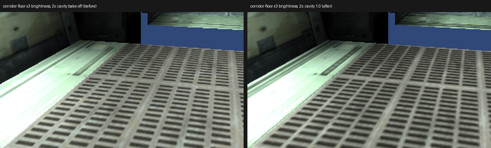
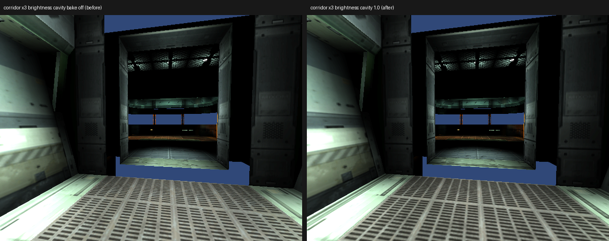

# Cavity bake comparison (mars_city1, 2026-11-23)

The world cook bakes each material's bump map into its diffuse texture as cavity shading
([RENDERING_ARCHITECTURE.md 10.2](../plans/RENDERING_ARCHITECTURE.md#102-normal-maps),
`BakeCavity` in `src/tools/assets/texture_pack.cpp`). Each diffuse texel's RGB is scaled by
`1 + amplitude x (clamp(N.L / L.z, 0.5, 1.5) - 1)`, with L a key light fixed in tangent space
at normalize(0.3, 0.3, 0.9). Nothing runs at draw time. These captures show what the bake
adds: the same views drawn with mars_city1's textures cooked without the bake (`cavity` 0) and
with it (`cavity` 1.0, `config/world_mars_city1.json`).

## Setup

- One debug ELF (built at `6d845c8`) and one D3WD (byte-identical across both cooks); only the D3TX
  differs: 288 textures and 2,592,768 bytes of VRAM unbaked, against 289 textures (200 baked)
  and 2,596,096 bytes baked.
- `make test-world-retail` NTSC (640x448, 32/32). The textured views come from the gate's
  `world-<view>-lit.tga`: diffuse textures, the lightmap pass and the material passes.
  Unbaked run `20261123T060111Z_world_retail_db358fb95611`; baked run
  `20261123T050021Z_world_retail_0647d1784a48`. Both passed.
- Only class A lights are baked, so the start room is dark: mean luma is 2 to 22 of 255.

## Captures

Each view has the two raw captures, a side-by-side sheet at x3 brightness (the same gain on
both sides, scaled to 640x480 for the 4:3 display) and the absolute difference x16.

| View | Before (no bake) | After (cavity 1.0) | Side by side, x3 | Difference x16 |
| --- | --- | --- | --- | --- |
| corridor | [before](../images/renderer-world-13-mars_city1-cavity-corridor-before-ntsc.png) | [after](../images/renderer-world-13-mars_city1-cavity-corridor-after-ntsc.png) | [compare](../images/renderer-world-13-mars_city1-cavity-corridor-compare-ntsc.png) | [diff](../images/renderer-world-13-mars_city1-cavity-corridor-diff-ntsc.png) |
| doorway | [before](../images/renderer-world-13-mars_city1-cavity-doorway-before-ntsc.png) | [after](../images/renderer-world-13-mars_city1-cavity-doorway-after-ntsc.png) | [compare](../images/renderer-world-13-mars_city1-cavity-doorway-compare-ntsc.png) | [diff](../images/renderer-world-13-mars_city1-cavity-doorway-diff-ntsc.png) |
| south | [before](../images/renderer-world-13-mars_city1-cavity-south-before-ntsc.png) | [after](../images/renderer-world-13-mars_city1-cavity-south-after-ntsc.png) | [compare](../images/renderer-world-13-mars_city1-cavity-south-compare-ntsc.png) | [diff](../images/renderer-world-13-mars_city1-cavity-south-diff-ntsc.png) |

The corridor's floor at 2x, x3 brightness:

## Measurements

Pixels whose difference exceeds 4 levels, and mean luma before and after:

| View | Changed | Mean luma |
| --- | --- | --- |
| corridor | 13.5 % | 21.6 → 20.0 |
| south | 5.3 % | 10.0 → 9.4 |
| doorway | 2.1 % | 7.4 → 7.1 |
| west | 5.4 % | 9.9 → 9.2 |
| east | 1.5 % | 3.7 → 3.4 |
| north, closed, fly | 0.2–0.6 % | unchanged within 0.2 |

## Findings

- **The relief is in the floor grates and panel seams.** The difference images are almost all
  floor tiles, trim and seams. Each grate tile's raised rim gets a lit edge and a shaded edge,
  so the grid reads as relief rather than a flat print. Broad wall surfaces barely change.
- **The bake darkens on average, 5 to 8 % of mean luma.** The key light is tilted, and these
  normal maps put more of their detail on the side facing away from it. A renormalised bake
  (keeping each texture's mean) or a lower `cavity` would hold the overall brightness.
- **Fine bump detail is lost to the texture size.** World textures cook at half the source
  size, 256 texels a side at most, so the bake keeps only the coarse relief.
- The relief always looks lit from the same tangent-space direction, whatever the room's real
  lights do. The plan's per-orientation variants (wall, floor, ceiling) are not built.

## Reproducing

1. Copy `config/world_mars_city1.json` with `textures.cavity` set to 0, then cook it elsewhere:
   `make world-cook-retail WORLD_RETAIL_JOB=<job> WORLD_COOK_OUTPUT=<dir>`. The rest of the
   cook (geometry, lightmaps) is unchanged.
2. `python3 src/tools/scripts/run_world_retail.py --world <dir>/mars_city1.d3wd --standard ntsc`
   (the D3TX beside the D3WD is the one staged), and `make test-world-retail` for the baked
   textures.
3. Compare the two runs' `world-<view>-lit.tga`.
